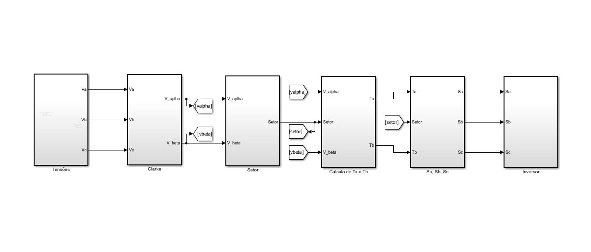
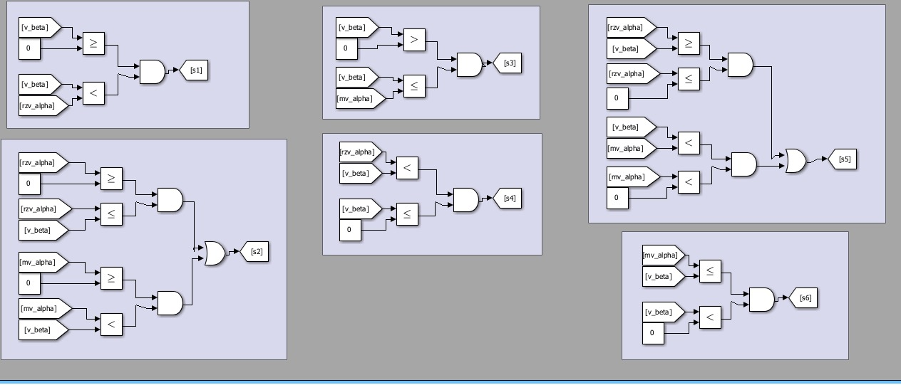
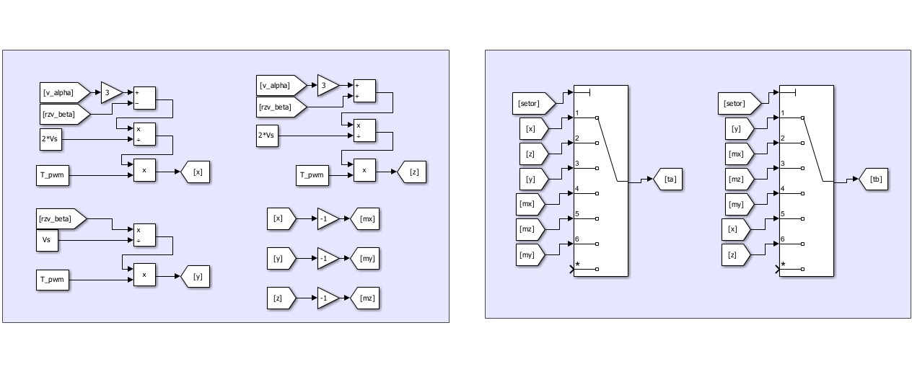
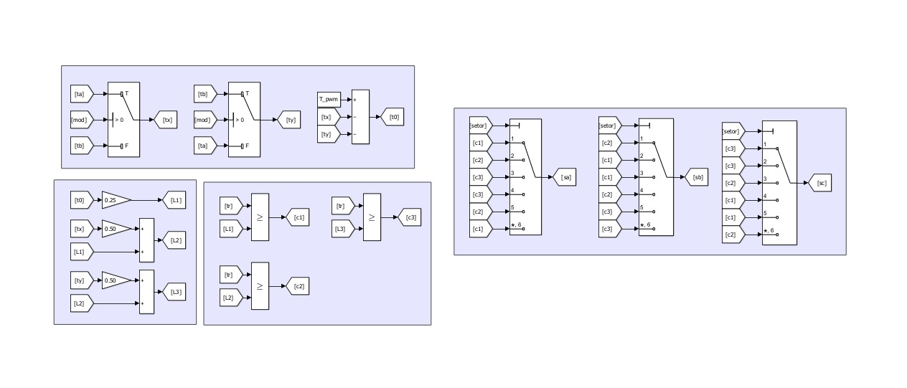
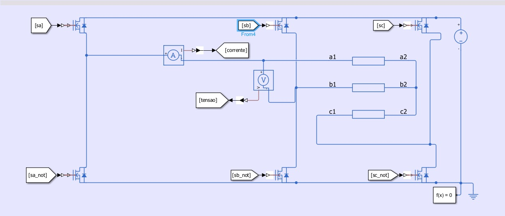
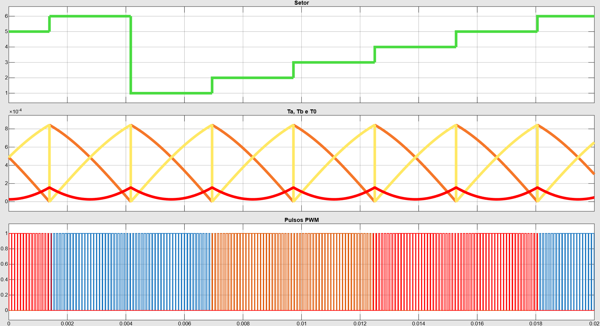

# Modelagem e Implementação Discreta de Modulador SVPWM Simétrico no MATLAB/Simulink

Este repositório contém a modelação analítica e simulação em nível de componentes do algoritmo de modulação por vetores espaciais (**Space Vector Pulse Width Modulation - SVPWM**) de 7 segmentos centrado, desenvolvido em ambiente MATLAB/Simulink para acionamento de inversores trifásicos aplicados a sistemas de tração elétrica de alto desempenho.

Diferente de abordagens baseadas em blocos pré-configurados de bibliotecas comerciais, esta implementação foi concebida de forma modular, permitindo a inspeção detalhada de cada etapa: transformadas matemáticas, deteção booleana de setores sem cálculo trigonométrico em ponto flutuante, cálculo de tempos dos vetores ativos e síntese simétrica com alocação ótima de vetores nulos.

---

## 📐 Cadeia de Processamento e Arquitetura Geral

O modelo organiza o processamento de sinais na seguinte sequência modular contínua:

1. **`Tensões` (Geração de Tensão Trifásica de Referência):**
   * Sintetiza o conjunto equilibrado de tensões senoidais de entrada nas fases $a$, $b$ e $c$:
     $$V_a(t) = V_{pico} \cdot \cos(\omega_e t)$$
     $$V_b(t) = V_{pico} \cdot \cos\left(\omega_e t - \frac{2\pi}{3}\right)$$
     $$V_c(t) = V_{pico} \cdot \cos\left(\omega_e t + \frac{2\pi}{3}\right)$$

2. **`Clarke` (Transformada $abc \to \alpha\beta$):**
   * Converte o sistema trifásico natural no referencial estacionário ortogonal bifásico através da formulação invariante em amplitude:
     $$V_\alpha = \frac{2}{3}V_a - \frac{1}{3}V_b - \frac{1}{3}V_c$$
     $$V_\beta = \frac{1}{\sqrt{3}}(V_b - V_c)$$

3. **`Setor` (Identificação Lógica do Setor Ativo):**
   * Elimina chamadas de funções trigonométricas de alto custo computacional (como `atan2`) em tempo real.
   * Utiliza comparadores analógicos e portas lógicas combinacionais baseadas nas relações de amplitude entre $V_\beta$, $\sqrt{3}V_\alpha$ e $-\sqrt{3}V_\alpha$ para determinar diretamente o setor $S \in \{1, 2, 3, 4, 5, 6\}$.

4. **`Cálculo de Ta e Tb` (Projeções dos Vetores Ativos):**
   * Determina os tempos de atuação $T_a$ e $T_b$ a partir do período de amostragem $T_{pwm}$ e da tensão do barramento CC $V_s$ ($V_{dc}$), calculando previamente as variáveis auxiliares:
     $$X = \frac{\sqrt{3} \cdot T_{pwm}}{V_s} \cdot V_\beta$$
     $$Y = \frac{\sqrt{3} \cdot T_{pwm}}{2 \cdot V_s} \cdot (\sqrt{3}V_\alpha + V_\beta)$$
     $$Z = \frac{\sqrt{3} \cdot T_{pwm}}{2 \cdot V_s} \cdot (-\sqrt{3}V_\alpha + V_\beta)$$
   * Roteia dinamicamente os valores calculados para $T_a$ e $T_b$ através de comutadores multi-porta orientados pelo setor.

5. **`Sa, Sb, Sc` (Síntese Simétrica Centrada e Geração de Pulsos):**
   * Ajusta a ordem de entrada dos vetores ativos conforme a paridade do setor (`mod 2`): $T_x$ e $T_y$.
   * Calcula o tempo residual nulo:
     $$T_0 = T_{pwm} - (T_x + T_y)$$
   * Estrutura os limites de comutação para a modulação simétrica de 7 segmentos:
     $$L_1 = 0{,}25 \cdot T_0$$
     $$L_2 = 0{,}50 \cdot T_x + L_1$$
     $$L_3 = 0{,}50 \cdot T_y + L_2$$
   * Compara com a portadora triangular $t_r$ de período $T_{pwm}$, gerando os sinais intermediários $c_1, c_2, c_3$ e mapeando-os para os disparos das fases $S_a, S_b, S_c$.

6. **`Inversor` (Ponte Trifásica e Carga):**
   * Ponte de 6 MOSFETs acionada pelos sinais $S_a, S_b, S_c$ e sinais complementares com tempo de comutação para evitar curto-circuito de braço.
   * Inclui medição de tensão de linha entre fases e sensores de corrente para carga trifásica resistivo-indutiva equilibrada.

---

## 📊 Parâmetros Nominais de Projeto

| Parâmetro | Símbolo | Valor Nominal | Unidade |
| :--- | :--- | :--- | :--- |
| Tensão do Barramento CC | $V_s$ ($V_{dc}$) | 400 | $\text{V}$ |
| Frequência de Chaveamento PWM | $f_{pwm}$ | 10.000 | $\text{Hz}$ |
| Período de Chaveamento | $T_{pwm}$ | 100 | $\mu\text{s}$ |
| Frequência da Tensão Fundamental | $f_e$ | 50 | $\text{Hz}$ |
| Período Fundamental | $T_e$ | 20 | $\text{ms}$ |
| Passo de Simulação (Solver Discreto) | $T_s$ | $1 \times 10^{-7}$ | $\text{s}$ |

---

## 📈 Validação Temporal e Formas de Onda

A simulação executada ao longo de um período fundamental completo ($20\text{ ms}$) no bloco `Scope` valida a estabilidade da modulação:

* **Transição Estável de Setores:** Comutação contínua de 1 a 6 em degraus limpos e sem saltos espúrios.
* **Continuidade dos Tempos:** Evolução suave de $T_a$, $T_b$ e $T_0$ na escala de microssegundos ($10^{-5}\text{ s}$), respeitando o limite $T_{pwm} = 100\ \mu\text{s}$.
* **Pulsos PWM Trifásicos:** Modulação simétrica centrada com rotação periódica entre as três fases comutadas, garantindo aproveitamento máximo do link CC (+15,47% em relação ao SPWM) e atenuação de perdas de chaveamento.

---